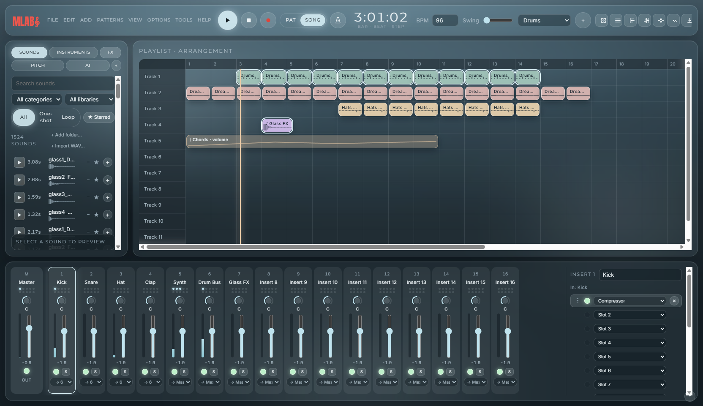
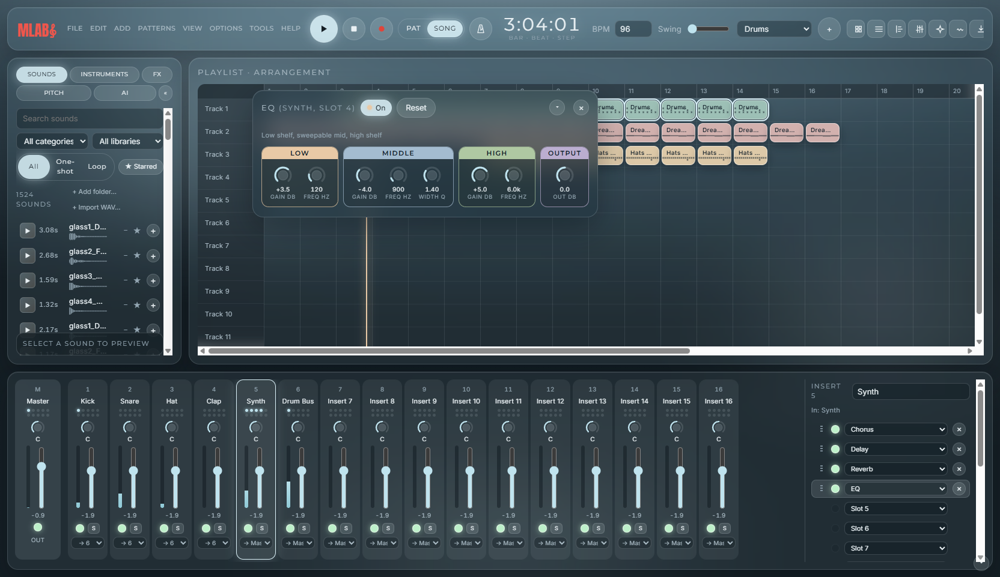
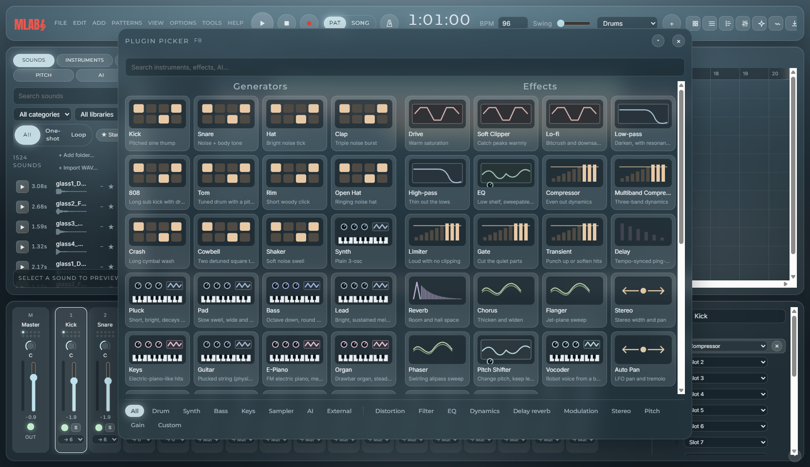
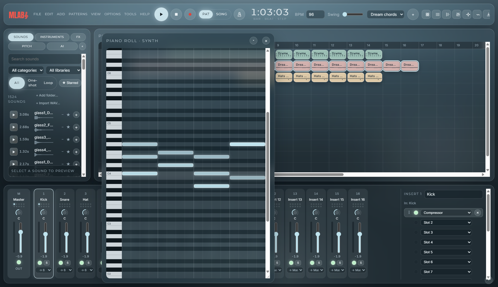
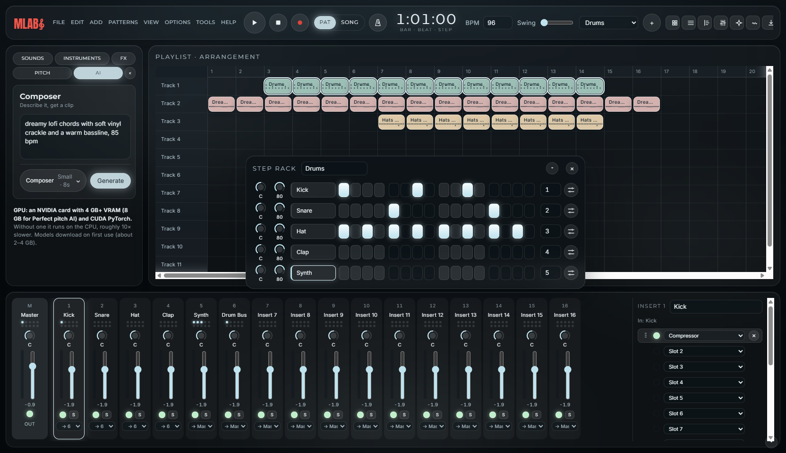

# MLabs

*Your next masterpiece.* A complete music studio built from the ground up: step sequencer, piano roll, playlist, a 16-insert mixer with 21 effects, and AI that composes, mixes, masters and turns your hum into any instrument. Python audio engine (numpy) with an HTML/CSS interface in a native desktop window (pywebview).



## Screenshots

| | |
|---|---|
|  |  |
| **Every effect has its own plugin window** (here the EQ: low shelf, sweepable mid, high shelf) | **Plugin picker (F8):** 11 drums, 18 synth/bass/keys presets, samplers and 21 effects |
|  |  |
| **Piano roll** with long, scrollable keys from C0 to B8 | **AI Composer** (text to music on your GPU), shown in the Dark theme |

## Install

MLabs runs on **Windows 10/11** (the window uses Microsoft Edge WebView2, which Windows 11 already has; on Windows 10 get the free "Evergreen" runtime from Microsoft if the window stays blank). macOS and Linux are untested.

**Install as is (everything, in one go):** with Python 3.12+ and Git installed, paste this into **cmd**. It installs every package, the free drum samples and the GPU build of PyTorch, then starts MLabs:
```
git clone https://github.com/Ramkasuru/MLabs.git && cd MLabs && pip install torch --index-url https://download.pytorch.org/whl/cu130 && pip install -r requirements.txt && python get_sounds.py && python app.py
```
(No NVIDIA GPU? It still works, just slower: the AI runs on the CPU.) Prefer to choose what gets installed? Follow the steps below.

1. Install **Python 3.12 or newer** from [python.org](https://www.python.org/downloads/) (tick "Add python.exe to PATH") and **Git** from [git-scm.com](https://git-scm.com/).
2. Open **cmd** and get the code:
   ```
   git clone https://github.com/Ramkasuru/MLabs.git
   cd MLabs
   ```
3. Optional but recommended: a virtual environment so MLabs' packages stay separate.
   ```
   python -m venv .venv
   .venv\Scripts\activate
   ```
4. **NVIDIA GPU?** Install the CUDA build of PyTorch first, so the AI runs on the graphics card:
   ```
   pip install torch --index-url https://download.pytorch.org/whl/cu130
   ```
   No NVIDIA GPU: skip this step; the AI still works on the CPU, about 10× slower.
5. Install everything else:
   ```
   pip install -r requirements.txt
   ```
6. Optional: free drum and percussion samples (VCSL, public domain, about 1.5 GB):
   ```
   python get_sounds.py
   ```
7. Start MLabs:
   ```
   python app.py
   ```
   Next time, just `cd MLabs` (and `.venv\Scripts\activate` if you made one), then `python app.py`.

Optional extras:
- **Custom VST3 plugins:** `pip install pedalboard` (GPL-3 licensed, so it is not installed by default), then use "Add custom plugin…" in the plugin picker (F8).
- **Self-check:** `python test_engine.py` runs 36 tests of the engine, AI roles and audio I/O.

**AI hardware:** **an NVIDIA GPU with 4 GB+ VRAM (8 GB for Perfect pitch AI) and the CUDA build of PyTorch.** Models download on first use (about 2–4 GB, cached afterwards) and load in the background at startup.

## Using MLabs

**Make a first beat**
1. Press **Space** to play and stop. The **Step Rack** (F6) shows one row per instrument; click the squares to turn steps on.
2. Add instruments from the **ADD** menu or the plugin picker (**F8**): drums, synths, bass, keys and samplers.
3. For melodies, select a channel and open the **piano roll** (**F7**). Click to draw notes, drag their ends to change length, right-drag to erase.
4. Sounds: open the **SOUNDS** tab on the left, click a row to preview, double-click to add it as a channel. "+ Add folder…" adds any folder of WAVs you already own.

**Build a song**
1. Make more patterns with **F4** (or the pattern menu in the top bar).
2. Switch the top bar from **PAT** to **SONG** and paint patterns onto the **playlist** (F5). Right-drag erases.
3. Drag a sound from the SOUNDS tab onto the playlist for an **audio clip**.
4. Right-click any volume or pan knob, or a mixer fader, and choose **Create automation clip** to draw a fade or sweep over time.

**Mix**
1. Open the **mixer** (**F9**). Each channel plays through its own insert track; the Step Rack shows the number.
2. Pick an effect in one of a track's 10 slots, then **double-click the slot** to open its plugin window with all of its knobs. Double-click a knob to reset it.
3. Route tracks to a group bus with the dropdown under each fader; mute and solo with the buttons above it.

**Use the AI** (left panel)
- **AI tab:** pick a role. **Composer** turns a text description into a music clip; **Mix engineer** balances levels and panning; **Mastering engineer** adds EQ, compression and a limiter on Master.
- **PITCH tab (Perfect pitch):** record a hum or an instrument, check the notes it heard, then turn them into a melody, guitar, bass, keys, pad or drum hits, or let the AI perform it.
- Every AI change can be undone with **Ctrl+Z**.

**Record and play live**
- Connect a MIDI keyboard and play the selected channel, or press **Ctrl+T** to play with your computer keyboard.
- The red **●** button records from your mic or audio interface; pick devices with **F10**.

**Save and export**
- **Ctrl+S** saves the project (a .json file); **Ctrl+O** opens one.
- **Ctrl+E** exports the song as WAV, FLAC or MP3, or as separate stems. **File → Export MIDI** saves the notes.

Lost a window? **F12** closes them all, and the **View** menu brings each one back. Options → Show tips replays the startup tips.

## What's in it

- **Workflow:** menu bar (File, Edit, Add, Patterns, View, Options, Tools, Help), Step Rack with step sequencer and right-click channel menu (rename, colour, fill each 2/4/8, rotate, copy/paste steps, clone, insert), piano roll C0–B8 (draw, erase by right-drag, velocity), playlist with painting and erasing by drag, **audio clips** (drag a sound onto the playlist) and **automation clips** (right-click any volume/pan knob or fader, then draw the curve), patterns (clone, delete, move, transpose, split by channel, render as audio clip), swing, metronome, precount, tempo tapper.
- **Instruments (Add menu and plugin picker, F8):** a wall of generators and effects with drawn previews and a category bar. 11 synthesized drums (Kick, Snare, Hat, Clap, 808, Tom, Rim, Open Hat, Crash, Cowbell, Shaker), 19 synth presets across Synth, Bass and Keys (FM E-Piano, Bell and Marimba, drawbar Organ, plucked-string Guitar and Harp, Strings, Brass, Supersaw…), 4 samplers, **MIDI Out** channels for external gear, and **custom VST3** instruments/effects ("Add custom plugin…") when the optional pedalboard add-on is installed.
- **Mixer:** 16 inserts plus Master, 10 effect slots each (drag to reorder), 3-band EQ, routing to group buses, mute/solo, meters. 21 effects, each with its own **plugin window** (double-click a slot) with knobs grouped in sections. Distortion: Drive, Soft Clipper, Lo-fi. Filter/EQ: Low-pass, High-pass (resonance, 12/24 dB), EQ (low shelf, sweepable mid with Q, high shelf). Dynamics: Compressor (attack, release, knee, mix), Multiband Compressor, Limiter, Gate, Transient. Delay/reverb: Delay (tone, ping-pong), Reverb (pre-delay, damping, width). Modulation: Chorus, Flanger, Phaser. Pitch: Pitch Shifter, Vocoder. Stereo/gain: Stereo, Auto Pan, Balance.
- **Sounds browser:** `samples/` plus any folders you add with "+ Add folder…" (read in place, never copied), with category, library and one-shot/loop filters, stars, waveform, duration and BPM, plus a preview player. Sampler channels: start/end, fades, reverse, normalize, DC removal, cut itself.
- **AI (pick a role like a model picker):** Composer (MusicGen text to music), Mix engineer, Mastering engineer, and **Perfect pitch**: record a hum or instrument, see the notes it heard, turn it into Melody, Guitar, Bass, Keys, Pad, Kick, Snare, Hat or Clap as exact notes, or have MusicGen Melody perform it.
- **Recording and live play:** mic or instrument takes (24-bit), live tuner, MIDI keyboard (Web MIDI), typing keyboard to piano (Ctrl+T), play history (turn what you just played into notes).
- **Tools:** Stop sound (Ctrl+H), cancel recording, performance mode, remove unused channels, purge unused audio, riff generator, **plugin performance monitor** (CPU, RAM, audio thread, render time per mixer track).
- **Customizable quick buttons** beside "+" in the top bar (Tools → Customize quick buttons). Every panel collapses; transitions are smooth and respect reduced motion.
- **Export:** WAV 16/24/32-bit float, FLAC 24-bit, MP3 320 kbps at 44.1/48/96 kHz, stems, and MIDI.
- **Look:** Misty or Dark theme, optional wallpaper, the MLabs startup screen (the treble clef draws itself), Inter + Montserrat + Anton fonts (bundled).

Shortcuts: Space play/stop · Ctrl+Z undo · Ctrl+S save · Ctrl+O open · Ctrl+E export · Ctrl+F browser find · Ctrl+H stop sound · Ctrl+T typing keyboard · Ctrl+M metronome · Ctrl+P precount · F2 rename pattern · F4 new pattern · F5 playlist · F6 rack · F7 piano roll · F8 plugin picker · Alt+F8 browser · F9 mixer · F10 audio & MIDI · F11 project info · F12 close windows.

## Project layout

| File | What it does |
|---|---|
| `app.py` | Window, audio streaming (sounddevice), recording, and the Python API the UI calls |
| `engine.py` | Synthesis, sampler, effects, mixer rendering, WAV/Ogg reading, export, MIDI export, pitch detection |
| `ai.py` | Composer and Perfect pitch (MusicGen), Mix and Mastering roles |
| `plugins.py` | Optional VST3 hosting through pedalboard |
| `ui/` | `index.html`, `style.css`, `app.js`, `logo.svg`, bundled fonts |
| `test_engine.py` | Self-checks: `python test_engine.py` |
| `FEATURES.md` | Feature list and roadmap |
| `THIRD_PARTY.md` | Fonts, sounds, models and their licences |

**Licence:** none yet, all rights reserved. MusicGen's model weights are non-commercial (CC-BY-NC 4.0); see THIRD_PARTY.md.

## How a project is put together

| Part | In the project file | In the app |
|---|---|---|
| Channels: one instrument per row, shared by every pattern | `project["channels"]` | Step Rack |
| Patterns: a step sequence plus piano-roll notes per channel | `pattern["steps"]`, `pattern["notes"]` (`[start, length, midi, velocity]`) | Step Rack, piano roll |
| Playlist: pattern, audio and automation clips placed in time | `project["playlist"]` on a 12-track × 32-bar grid | Playlist |
| Mixer: channels feed insert tracks, inserts route to Master or a group bus | `project["mixer"]`: Master + 16 inserts, each with 10 FX slots, EQ, fader, pan, mute/solo, routing | Mixer, plugin windows |

See [FEATURES.md](FEATURES.md) for the full feature list and roadmap.

## Built with

MLabs stands on these open-source projects. Thank you to everyone who maintains them.

**Audio, app and AI**

| Project | Used for |
|---|---|
| [NumPy](https://github.com/numpy/numpy) and [SciPy](https://github.com/scipy/scipy) | The whole audio engine: synthesis, effects, mixing, resampling |
| [pywebview](https://github.com/r0x0r/pywebview) | The native desktop window around the HTML/CSS interface |
| [python-sounddevice](https://github.com/spatialaudio/python-sounddevice) | Live playback, recording and the tuner |
| [python-soundfile](https://github.com/bastibe/python-soundfile) | Reading and writing WAV, FLAC and MP3 |
| [psutil](https://github.com/giampaolo/psutil) | CPU and RAM in the performance monitor |
| [PyTorch](https://github.com/pytorch/pytorch) and [Transformers](https://github.com/huggingface/transformers) | Running the AI models on your GPU |
| [AudioCraft / MusicGen](https://github.com/facebookresearch/audiocraft) (Meta) | AI Composer and Perfect pitch AI (weights are non-commercial, CC-BY-NC 4.0) |
| [pedalboard](https://github.com/spotify/pedalboard) (Spotify) | Optional VST3 plugin hosting (GPL-3, not installed by default) |

**Sounds and fonts**

| Project | Used for |
|---|---|
| [VCSL](https://github.com/sgossner/VCSL) (Versilian Community Sample Library) | Free drum and percussion samples from `get_sounds.py` (CC0) |
| [Inter](https://github.com/rsms/inter), [Montserrat](https://github.com/JulietaUla/Montserrat), [Anton](https://github.com/googlefonts/AntonFont) | Interface, headings and logo fonts (SIL Open Font License) |

**Development tools**

| Project | Used for |
|---|---|
| [Claude Code](https://github.com/anthropics/claude-code) | AI pair programmer used to build and test MLabs |
| [UI UX Pro Max skill](https://github.com/nextlevelbuilder/ui-ux-pro-max-skill) | Design system guidance for the interface |

Licences for everything bundled or downloaded are listed in [THIRD_PARTY.md](THIRD_PARTY.md).

## Open-source generative models to choose from

Check each model card for current license terms. Rows marked * come from third-party reports and are not yet confirmed against the model card.

### Audio generation (makes sound)
| Model | What it does | License | Fit |
|---|---|---|---|
| **MusicGen / MusicGen-Melody** (Meta AudioCraft) | Text-to-music, 300M-3.3B. The Melody variant follows a hummed tune. | Code MIT, weights **CC-BY-NC 4.0 (non-commercial)** | Wired in now. Easy to run. |
| **Stable Audio Open 1.0 / Small** (Stability AI) | Text-to-audio, up to ~47 s. Strong for drum loops, one-shots and sound design. | Stability AI Community License (free under the revenue cap) | Best for generating samples and loops for the rack |
| Stable Audio 3* | New open-weight family, reportedly trained on licensed data | Stability Community License* | Watch this one |
| **ACE-Step (1.5)** | Fast full songs with vocals and lyrics. v1.5 reportedly runs in under 4 GB VRAM*. | Apache 2.0 | Best permissive full-song model |
| **YuE** | Lyrics-to-full-song with vocals, long form | Apache 2.0 | High quality, heavy on VRAM |
| **DiffRhythm 2** | Diffusion full-song generation, fast | Apache 2.0* | Alternative to ACE-Step |
| **Magenta RealTime** (Google) | Streaming music generation you can steer live | Code Apache 2.0, weights CC-BY 4.0 | Live jamming and layering |
| **InspireMusic** (Alibaba) | Text-to-music, long-form | Apache 2.0 | Alternative |
| MiniMax Music 3.0* | ~11B, five-minute songs (released Aug 2026) | Community license; companies over $20M revenue need permission* | Highest quality, needs large hardware |

### Symbolic generation (writes notes into the piano roll)
| Model | What it does | License |
|---|---|---|
| **Anticipatory Music Transformer** (Stanford) | Generates accompaniment or infills MIDI around existing notes. Good for adding layers. | Apache 2.0 |
| Magenta Music Transformer / MusicVAE | Melody, drum and interpolation models. Older but light. | Apache 2.0 |
| Any local text LLM (via `airllm`) | Prompt it to return note JSON. airllm runs big LLMs layer by layer on small GPUs, slowly. | Varies by model |

### Detection ("perfect pitch" and sound recognition)
| Model | What it does | License |
|---|---|---|
| **Basic Pitch** (Spotify) | Polyphonic audio-to-MIDI, light and fast | Apache 2.0 |
| **CREPE / torchcrepe** | Very accurate monophonic pitch | MIT |
| **MT3 / YourMT3** | Multi-instrument transcription (drums, bass, piano...) | Apache 2.0 |
| **Demucs** (Meta) | Splits a mix into drums, bass, vocals and other stems before transcribing | MIT |

**Suggested stack:** Demucs, then Basic Pitch for detecting notes. Stable Audio Open or ACE-Step for generating audio (commercial-friendly). Anticipatory Music Transformer for MIDI layers. MusicGen is fine for experiments, but its weights are non-commercial.
